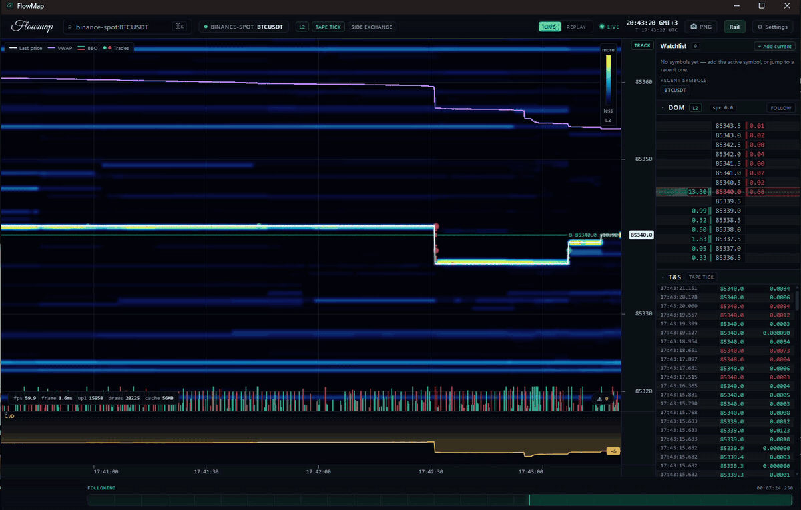
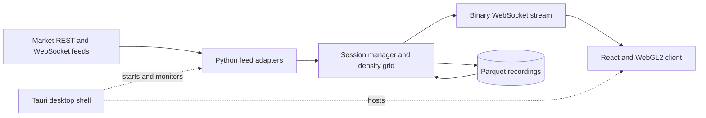

# FlowMap Trade Terminal

[](https://github.com/nazmiefearmutcu/flowmap/actions/workflows/ci.yml)

FlowMap Trade Terminal is a desktop application for studying liquidity and order flow in crypto and US equities. It combines a live liquidity heatmap, a depth-of-market ladder, time and sales, and recorded-session replay. It reads market data and supports visual analysis; it does not place orders or hold funds.

[Download releases](https://github.com/nazmiefearmutcu/flowmap/releases/latest) · [User guide](docs/user-guide.md) · [Architecture](docs/architecture.md)

## What it does

- Displays bid and ask liquidity with a WebGL2 heatmap, adjustable price and time scales, and sum, bid, ask, or imbalance views.
- Adds trade bubbles, best bid and offer, VWAP, cumulative volume delta, volume profile, and feed-gap markers.
- Provides symbol search, watchlists, drawings, technical indicators, and local price alerts.
- Records sessions to Parquet and replays the recorded data with seeking, pause, and speed controls. Recording is on by default in the installed app; turn it off under Settings > Data, or set `"enabled": false` in `recording.json` in the app data folder before launch (see [SECURITY.md](SECURITY.md#what-it-writes)). From source, `FLOWMAP_RECORDING_ENABLED=0` turns it off. The default soft limit is 20 GB; the oldest recording parts are removed as it is exceeded, except the `*-epochs-*` parts, which are kept.
- Offers two chart styles in Settings > Display: *Normal*, the smooth heatmap (default), and *Pixel*, which draws blocks in the theme colours.
- Exports chart images and finalized depth columns as CSV or JSON.
- Runs in a Tauri desktop shell or as a local browser client. The interface supports English and Turkish, themes, and keyboard controls. Settings > Keyboard can turn off the single-key shortcuts. Its typefaces are bundled, so the client loads nothing from the web. Settings > About and legal shows the version, the licence and the data-source attribution.

### Live market example


### Sixteen-hour view


### Live price tracking



## Market data and its limits

| Feed | Available data | Important distinction |
|---|---|---|
| Native crypto connectors | Incremental L2 books and trade events from supported Binance, Bybit, Coinbase, Deribit, and OKX markets | Channels and update cadence depend on the venue and market segment. |
| Other supported CCXT venues | Order-book snapshots and available trade feeds | Snapshot or polling coverage is different from a native incremental feed. |
| Keyless US equities | A synthetic liquidity profile derived from Yahoo bar data | The `SYNTH` label identifies an estimate, not observed resting orders. |
| Optional Alpaca / Finnhub credentials | Equity L1 quotes and/or trade tape, according to provider support | These feeds do not turn an equity session into an L2 order book. |
| `sim:SIM-DEMO` | Deterministic demonstration data | Works offline; contains no live market observations. |

### Data providers, attribution and limits

FlowMap displays market data that other companies publish. It does not own that data, and it does
not resell it. The providers that a feed can use are the ones in the table above, plus the public
sources listed in the [security guide](SECURITY.md#where-it-connects). Crypto venue data comes from
Binance, Bybit, Coinbase, Deribit and OKX (and CCXT venues); equity history and display quotes come from
unofficial Yahoo Finance endpoints, and the keyless last price from an unofficial Google Finance page.
The macro (FRED), dark-pool (FINRA), politics (House Stock Watcher), aviation (OpenSky Network), contract (USAspending) and job-board (Greenhouse) feed modules exist, but no producer runs in this build, so those sources are not contacted today. Each provider's terms of use apply to the data you view through FlowMap. Check them
before you rely on the data, redistribute a screenshot, or build on the same endpoints.

Data can be delayed, incomplete or unavailable. Keyless sources can stop without notice. **FlowMap
is not investment advice,** does not recommend any security, and is not a broker. Nothing shown
here is an offer to buy or sell.

Feed badges show the active data tier and tape source. Replay uses available recordings; it cannot recover unrecorded historical depth. Network failures, source gaps, and aggregation affect what can be shown. The application is an analysis tool, and its indicators do not establish trading performance.

## Architecture



- **`server/`** contains the Python 3.13 FastAPI service. Crocodile adapters normalize crypto events; equity and simulation adapters use the same session protocol. The service manages the density grid, recordings, replay, and HTTP endpoints.
- **`client/`** contains the React, TypeScript, and WebGL2 renderer. It receives binary depth columns and market events, caches chart history, and draws overlays and interaction tools.
- **`app/`** contains the Tauri 2 Rust shell. Packaged builds include the client and a relocatable Python runtime. The shell starts the local service, monitors its health, and stops it when the application closes.

The service binds to loopback and refuses any request whose `Host` header is not a loopback name, which blocks DNS rebinding. The installed app also gives each launch a random session token that every request (except the health probe and CORS preflight) and every WebSocket connection must present, so a web page in your browser cannot read the API. Source runs set no token. There is still no user authentication: the operating-system account is the boundary. See [SECURITY.md](SECURITY.md) for the network and storage model, and [docs/architecture.md](docs/architecture.md) for protocol and replay details.

## Run from source

Use Python 3.13+, [uv](https://docs.astral.sh/uv/), and Node.js 22.13+ or 24 with npm. Rust 1.89 or newer is needed only to build or test the desktop shell in `app/`. Packaged releases bundle their runtime and do not need a source setup.

```bash
git clone https://github.com/nazmiefearmutcu/flowmap.git
cd flowmap
```

Start the service in one terminal:

```bash
cd server
uv sync
uv run python -m flowmap_server
```

Start the client from the repository root in another terminal:

```bash
cd client
npm ci
npm run dev
```

Open <http://localhost:5173>. The development client connects directly to `127.0.0.1:8720` (set `FLOWMAP_DEV_SERVER_PORT`, or `FLOWMAP_PORT`, to change it), with a proxy fallback. Select `SIM-DEMO` to check the interface without a network connection, or choose a live symbol such as `BTCUSDT`.

The server resolves Crocodile from the wheel included in `server/vendor/`. Source helpers are also available at [scripts/dev.sh](scripts/dev.sh), [scripts/dev-windows.ps1](scripts/dev-windows.ps1) and [scripts/dev-unix.sh](scripts/dev-unix.sh); these disable recording unless explicitly enabled. For Windows paths containing non-ASCII characters, see the troubleshooting guidance in the [user guide](docs/user-guide.md).

## Configuration

Set environment variables before starting the service. Common settings are:

| Variable | Default / use |
|---|---|
| `FLOWMAP_HOST` | `127.0.0.1`; loopback only. Any other host is refused at startup. |
| `FLOWMAP_PORT` | `8720`; source runs listen here. The development client (`client/vite.config.ts`) connects to `FLOWMAP_DEV_SERVER_PORT` when it is set and otherwise to this port, so setting `FLOWMAP_PORT` alone moves both. |
| `FLOWMAP_LOG_LEVEL` | `info`; server log verbosity. |
| `FLOWMAP_LOG_FILE` | Unset; when set, server logs are written to this file. At 20 MB it rotates to `.1`, keeping three numbered backups (`.1` to `.3`). |
| `FLOWMAP_DATA_DIR` | Source runs: recordings default to `~/.flowmap/recordings` and the intelligence store (`warehouse.duckdb`) to `~/.flowmap/intelligence`. Setting this moves both. The installed app uses its app data directory; see the [security guide](SECURITY.md#what-it-writes). |
| `FLOWMAP_RECORDING_ENABLED` | `1`; set to `0` to disable recording. The dev launchers default to `0`, and the installed app sets `1`. Accepts 0/1, false/true, no/yes or off/on; any other value is refused at startup. |
| `FLOWMAP_RECORDING_GB_CAP` | `20.0`; soft disk budget for recordings, in GB. `*-epochs-*` parts are never deleted, so the total can exceed the cap. |
| `FLOWMAP_FLUSH_INTERVAL_S` | `10.0`; recording flush cadence, in seconds. |
| `FLOWMAP_RETENTION_MIN_INTERVAL_S` | `60.0`; minimum seconds between recording retention sweeps. |
| `FLOWMAP_MAX_SESSIONS` | `4`; concurrent subscriptions. Each session holds an in-memory ring of up to 256 MiB (crypto) or 512 MiB (equity), so the default allows about 2 GiB of ring memory in the worst case. |
| `FLOWMAP_WS_MAX_CONNECTIONS` | `16`; WebSocket connection cap for the process. |
| `FLOWMAP_WS_ALLOWED_ORIGINS` | Unset: any loopback `http` origin and the desktop shell origins. When set, it replaces that list (comma-separated); `*` accepts any origin and is for development only. |
| `FLOWMAP_EXIT_ON_STDIN_EOF` | `0`; when `1`, the server shuts down cleanly (flushing its recorder) once its stdin closes. The desktop shell sets it. |
| `FLOWMAP_BENCHMARK_PROVENANCE`, `FLOWMAP_BENCHMARK_OWNER`, `FLOWMAP_BENCHMARK_PROFILE` | Unset. Used only by the Windows benchmark harness (`scripts/windows-benchmark`); a normal run never imports that code. |
| `FLOWMAP_CRYPTO_TICK` | `0`; crypto price tick size. `0` chooses it automatically. |
| `FLOWMAP_BOOK_TOP_N` | `20000`; order-book depth cap (levels). |
| `FLOWMAP_RING_COLUMNS` | `32768`; in-memory history columns per session (256 to 65536). Larger values use more memory. |
| `FLOWMAP_REPLAY_MAX_COLS` | `0`; replay window cap in columns. `0` follows the ring size. |
| `FLOWMAP_BACKFILL_ENABLED` | `1`; fetch historical candles on the first subscribe (Binance klines for crypto, Yahoo bars for keyless equities). `0` keeps those requests off. Same boolean spellings as `FLOWMAP_RECORDING_ENABLED`. |
| `FLOWMAP_BACKFILL_MAX_COLS` | `512`; cap on backfilled columns per session. |
| `FLOWMAP_BACKFILL_SHAPE` | `erode`; how backfilled candles are drawn. `flat` restores the previous rendering. |
| `FLOWMAP_BACKFILL_STRETCH` | `16`; depth columns drawn per reconstructed candle (1 to 240). |
| `FLOWMAP_DT_CRYPTO_NS` | `250000000`; crypto update cadence, in nanoseconds. Between 1 ms and 1 hour. |
| `FLOWMAP_DT_EQUITY_KEYLESS_NS` | `10000000000`; keyless equity update cadence (10 s). Between 1 ms and 1 hour. |
| `FLOWMAP_DT_EQUITY_KEYLESS_GRID_NS` | `1000000000`; keyless equity grid cadence (1 s). Between 1 ms and 1 hour. |
| `ALPACA_API_KEY`, `ALPACA_API_SECRET` | Optional equity market-data credentials; supply both. Read by a source run. The installed app does not pass them to its server. |
| `FINNHUB_API_KEY` | Optional equity tape access. Read by a source run; the installed app does not pass it to its server. |
| `FLOWMAP_SESSION_TOKEN` | Set by the desktop shell at each launch; when present, every request (except `/api/health` and CORS preflight) must send it in `X-FlowMap-Token`, and every WebSocket connection must offer it as the `flowmap.auth.<token>` subprotocol (on a WebSocket, the `token` query parameter is accepted for tools). Leave it unset for source runs. |

Logs in the installed app go to the app data folder: `flowmap-server.log` (the server's output, moved to `flowmap-server.previous.log` at 20 MB) and `shell.log` (the shell's lifecycle messages, moved to `shell.previous.log` at 1 MB, at the next launch). The per-OS paths are in the [security guide](SECURITY.md#what-it-writes).

Defaults and validation are defined in [config.py](server/src/flowmap_server/config.py). Use market-data credentials appropriate to the provider; FlowMap has no order-execution integration.

## Development and documentation

```bash
# In client/
npm test
npm run lint
npm run build

# In server/
uv run pytest -q
uv run ruff check .
```

[Development guide](docs/development.md) covers browser end-to-end tests, the Rust shell, and packaging. See the [desktop build guide](app/README.md), [contribution guide](CONTRIBUTING.md), [changelog](CHANGELOG.md), and [roadmap](ROADMAP.md) for further work.

## License

[Apache License 2.0](LICENSE).

## Minimum

These are **estimates, not validated minimums.** The only measured system is listed as the tested
configuration below, and the [benchmark notes](docs/windows-minimum-benchmark.md) record that the
minimum-hardware qualification is NOT QUALIFIED.

| Component | Minimum (estimate) |
|---|---|
| Windows | Windows 10 22H2 / 11 |
| macOS | Configured floor: macOS 12.0. The computed minimum is in each macOS build's `macos-runtime-minimum-<triple>` workflow artifact, not in the release notes. Intel or Apple Silicon |
| Linux | Ubuntu 22.04 LTS (64-bit) |
| Processor | Intel Core i3-10100 / AMD Ryzen 3 3100 |
| Memory | 8 GB RAM |
| Graphics | NVIDIA GeForce GT 1030 (2 GB) / AMD Radeon RX 550 (2 GB) |
| Storage | 2 GB free space, plus recordings |
| Display | 900 × 600 |

| Tested configuration | Measured system |
|---|---|
| Windows (benchmark) | AMD Ryzen 7 PRO 5750G, Radeon R7 200 (Oland), 32 GiB RAM. Status: NOT QUALIFIED for the minimum above |

Copyright 2026 Nazmi Efe Armutcu. Created by Aylin (Nazmi Efe Armutcu). Third-party components and
their licences are listed in [NOTICE](NOTICE). Each release also attaches `THIRD-PARTY-NOTICES.txt`,
with one section per installer target, named by its Rust target triple, for the Python distributions in that platform's bundled runtime, and shared sections for the production client packages and the Rust crates of the desktop shell, each with the licence it declares.
