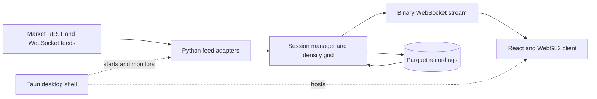

# FlowMap Trade Terminal

[](https://github.com/nazmiefearmutcu/flowmap/actions/workflows/ci.yml)

FlowMap Trade Terminal is a desktop application for studying liquidity and order flow in crypto and US equities. It combines a live depth heatmap, a depth-of-market ladder, time and sales, and recorded-session replay. It reads market data and supports visual analysis; it does not place orders or hold funds.

[Download releases](https://github.com/nazmiefearmutcu/flowmap/releases/latest) · [User guide](docs/user-guide.md) · [Architecture](docs/architecture.md)

## What it does

- Displays bid and ask liquidity with a WebGL2 heatmap, adjustable price and time scales, and sum, bid, ask, or imbalance views.
- Adds trade bubbles, best bid and offer, VWAP, cumulative volume delta, volume profile, and feed-gap markers.
- Provides symbol search, watchlists, drawings, technical indicators, and local price alerts.
- Records sessions to Parquet and replays the recorded data with seeking, pause, and speed controls. The default recording limit is 20 GB; older recordings are removed when the cap is exceeded.
- Exports chart images and finalized depth columns as CSV or JSON.
- Runs in a Tauri desktop shell or as a local browser client. The interface supports English and Turkish, themes, and keyboard controls.

### Live market example


### Sixteen-hour view


## Market data and its limits

| Feed | Available data | Important distinction |
|---|---|---|
| Native crypto connectors | Incremental L2 books and trade events from supported Binance, Bybit, Coinbase, Deribit, and OKX markets | Channels and update cadence depend on the venue and market segment. |
| Other supported CCXT venues | Order-book snapshots and available trade feeds | Snapshot or polling coverage is different from a native incremental feed. |
| Keyless US equities | A synthetic liquidity profile derived from Yahoo bar data | The `SYNTH` label identifies an estimate, not observed resting orders. |
| Optional Alpaca / Finnhub credentials | Equity L1 quotes and/or trade tape, according to provider support | These feeds do not turn an equity session into an L2 order book. |
| `sim:SIM-DEMO` | Deterministic demonstration data | Works offline; contains no live market observations. |

Feed badges show the active data tier and tape source. Replay uses available recordings; it cannot recover unrecorded historical depth. Network failures, source gaps, and aggregation affect what can be shown. The application is an analysis tool, and its indicators do not establish trading performance.

## Architecture



- **`server/`** contains the Python 3.13 FastAPI service. Crocodile adapters normalize crypto events; equity and simulation adapters use the same session protocol. The service manages the density grid, recordings, replay, and HTTP endpoints.
- **`client/`** contains the React, TypeScript, and WebGL2 renderer. It receives binary depth columns and market events, caches chart history, and draws overlays and interaction tools.
- **`app/`** contains the Tauri 2 Rust shell. Packaged builds include the client and a relocatable Python runtime. The shell starts the local service, monitors its health, and stops it when the application closes.

The service binds to loopback. It is intended for local use and has no user authentication. See [SECURITY.md](SECURITY.md) for the network and storage model, and [docs/architecture.md](docs/architecture.md) for protocol and replay details.

## Run from source

Use Python 3.13+, [uv](https://docs.astral.sh/uv/), and Node.js 22.13+ or 24 with npm. Packaged releases bundle their runtime and do not need a source setup.

```bash
git clone https://github.com/nazmiefearmutcu/flowmap.git
cd flowmap
```

Start the service in one terminal:

```bash
cd server
uv sync
uv run python -m flowmap_server
```

Start the client from the repository root in another terminal:

```bash
cd client
npm ci
npm run dev
```

Open <http://localhost:5173>. The development client connects directly to `127.0.0.1:8720`, with a proxy fallback. Select `SIM-DEMO` to check the interface without a network connection, or choose a live symbol such as `BTCUSDT`.

The server resolves Crocodile from the wheel included in `server/vendor/`. Source helpers are also available at [scripts/dev-windows.ps1](scripts/dev-windows.ps1) and [scripts/dev-unix.sh](scripts/dev-unix.sh); these disable recording unless explicitly enabled. For Windows paths containing non-ASCII characters, see the troubleshooting guidance in the [user guide](docs/user-guide.md).

## Configuration

Set environment variables before starting the service. Common settings are:

| Variable | Default / use |
|---|---|
| `FLOWMAP_PORT` | `8720`; the development proxy expects this port. |
| `FLOWMAP_RECORDING_ENABLED` | `1`; set to `0` to disable recording. |
| `FLOWMAP_DATA_DIR` | `~/.flowmap/recordings` for a source run. |
| `FLOWMAP_RECORDING_GB_CAP` | `20.0`; disk budget for recordings. |
| `FLOWMAP_MAX_SESSIONS` | `4`; concurrent subscriptions. |
| `ALPACA_API_KEY`, `ALPACA_API_SECRET` | Optional equity market-data credentials; supply both. |
| `FINNHUB_API_KEY` | Optional equity tape access. |

Defaults and validation are defined in [config.py](server/src/flowmap_server/config.py). Use market-data credentials appropriate to the provider; FlowMap has no order-execution integration.

## Development and documentation

```bash
# In client/
npm test
npm run lint
npm run build

# In server/
uv run pytest -q
uv run ruff check .
```

[Development guide](docs/development.md) covers browser end-to-end tests, the Rust shell, and packaging. See the [desktop build guide](app/README.md), [contribution guide](CONTRIBUTING.md), [changelog](CHANGELOG.md), and [roadmap](ROADMAP.md) for further work.

## License

[Apache License 2.0](LICENSE).

## Minimum

Estimated minimum requirements. See [benchmark notes](docs/windows-minimum-benchmark.md) for validation limits.

| Component | Minimum |
|---|---|
| Windows | Windows 10 22H2 / 11 |
| macOS | macOS 14.0, Intel or Apple Silicon |
| Linux | Ubuntu 22.04 LTS (64-bit) |
| Processor | Intel Core i3-10100 / AMD Ryzen 3 3100 |
| Memory | 8 GB RAM |
| Graphics | NVIDIA GeForce GT 1030 (2 GB) / AMD Radeon RX 550 (2 GB) |
| Storage | 2 GB free space, plus recordings |
| Display | 900 × 600 |

Created By Nazmi Efe Armutcu (Aylin)
